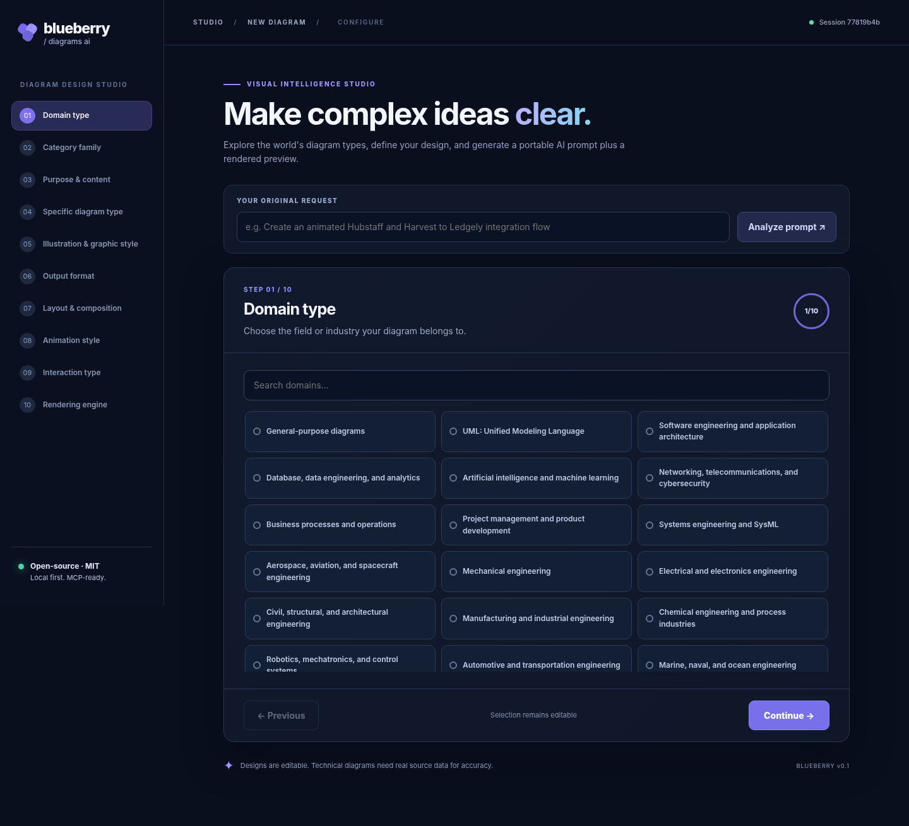

# Blueberry Diagrams AI

**An open-source, local-first AI diagram wizard and reusable prompt generator**

Blueberry helps users classify, configure, preview, and export diagrams. It integrates with AI assistants through MCP and works as a browser wizard when native in-chat forms are unavailable.

**Release status: v0.1.0 prototype, not yet published to npm or GitHub.** The repository name is `blueberry-diagrams-ai`, npm package name is provisionally `blueberry-diagrams`, and the command is `blueberry`. Check npm availability again before publication.



## Quick start

Requires **Node.js 22+**. No third-party npm dependencies, CDN assets, account, or API key needed to run locally.

```bash
# From this repository:
node bin/blueberry.js serve
# Open http://127.0.0.1:3847/wizard
```

Install the command locally from the project root:

```bash
npm link
blueberry
```

Once the npm name has been confirmed **and** the package published:

```bash
npm install -g blueberry-diagrams
blueberry
```

`blueberry` opens a local HTTP server and displays the wizard URL (it does not automatically open your browser). Also available: `blueberry catalog`, `blueberry mcp`, and `blueberry create "Cart -> Payment -> Receipt"`.

## User workflow

1. Prompt recognized (through MCP, or entered into the web wizard)
2. Domain: 42 choices from the original catalog, plus Other
3. Category family: diagram family within the domain, plus Other
4. Purpose: suggested reasons plus free text and real node/edge/data input
5. Specific diagram type: 972 catalog entries in domain-filtered categories, plus Other
6. Illustration / Graphic Style: 15 style families and 75 graphic styles
7. Output: HTML5, SVG, PNG, JPEG, GIF, WebM, MP4, PDF
8. Layout: 20 choices
9. Animation: None or 28 effects; the initial renderer supports a subset
10. Interaction: None or 18 interaction models; basic playback applies in HTML5
11. Rendering engine: Auto, optional advanced selection; automatically skipped if animation is None, but the underlying renderer is still selected
12. Review: show chosen classification and real content; explicit **Yes** or **No** gate
13. After Yes: generate a cross-platform, copyable prompt and an actual preview of the chosen format, with editing and regeneration

Any missing relationships/data are replaced only with a clearly **illustrative** placeholder, never passed off as a verified technical model. The wizard saves sessions in process memory (not durable after a restart).

## Supported rendering vs. catalog coverage

The full taxonomy drives the selection UI, but **catalog inclusion is not full semantic rendering support**. This prototype's native SVG renderer supports:

- General flowcharts, integrations, workflows, state/architecture-style blocks
- UML-like sequence lifelines and messages (simplified, not standards-validated)
- Generic bar charts when `label: value` pairs are entered
- Graph/node-link previews
- Layered/isometric-style component diagrams
- Basic dark, blueprint, hand-drawn and other visual themes
- SVG dashed line flow, reveal and pulsing effects in supported views

Features like flight dynamics simulation, medical 3D anatomy, CAD, true geographic GIS layers, force-directed Canvas physics, full BPMN/UML conformance, arbitrary animation presets, and interactive editing of every type are **future renderer modules**, not implemented. Selecting a specialized engine currently falls back to a simple SVG-based diagram and should not be treated as specialized scientific output.

## Output format details

| Format | Preview/export | Notes |
|---|---|---|
| HTML5 | Self-contained browser HTML | Editable source, basic play/pause/replay/speed controls |
| SVG | SVG preview/download | Paths and elements remain vector; animations depend on SVG viewer |
| PNG / JPEG | Browser rasterization | Static image output |
| GIF | Browser-side RGB332 GIF encoding | Animated preview; larger than optimized GIF files |
| WebM | Browser MediaRecorder | Requires `MediaRecorder` + `canvas.captureStream` support |
| MP4 | Browser MediaRecorder or optional local FFmpeg conversion | On a local server with FFmpeg installed, WebM previews are converted automatically; remote conversion is disabled by default |
| PDF | Browser Print → Save as PDF | Uses the browser's print dialog, not a PDF file generator |

Static formats do not support clickable controls. HTML5 includes the basic controls, not every selection in the interaction catalog. GIF, WebM, and MP4 are animated only if animations are enabled.

## AI platform integration

Blueberry implements a dependency-free subset of MCP over **stdio** and **Streamable HTTP**. Its exposed tools are:

- `blueberry_start`
- `blueberry_catalog`
- `blueberry_update`
- `blueberry_review`
- `blueberry_confirm`
- `blueberry_generate`

The tool descriptions guide assistants to trigger the wizard when users request any diagram. A platform may not automatically run it, and not all clients support native in-chat multiple-choice forms. The browser wizard is the shared fallback.

| Platform | Available path | Caveat |
|---|---|---|
| Claude Code / Desktop | `blueberry mcp` stdio | See `adapters/claude-*` |
| Gemini CLI | `blueberry mcp` stdio | See `adapters/gemini-*` |
| ChatGPT web | Remotely hosted HTTPS `/mcp` custom app | Supported account/workspace, authentication, and approvals required |
| Grok web/API | Remote HTTPS `/mcp` connector | Grok OAuth requirements may need an external OAuth gateway |
| Codex and similar coding agents | Local MCP stdio | See `adapters/codex-config.toml` |

Use the instructions in `adapters/`. All platforms can use the copied prompt even without MCP installation.

### MCP stdio

```bash
blueberry mcp
```

MCP stdio starts a small localhost wizard server automatically if the default port is free. If another server is already using the port, the MCP tools still work in-chat. Set `BLUEBERRY_NO_WEB=1` to disable this convenience.

### Optional self-hosting

```bash
BLUEBERRY_TOKEN='REPLACE_WITH_A_LONG_RANDOM_SECRET' blueberry serve --host 0.0.0.0 --port 3847
```

**Security:** Never expose this bare prototype directly to the public internet. Put it behind TLS and a properly authenticated gateway/reverse proxy; it does not implement OAuth2, accounts, durable storage, rate limiting, user isolation, or production multi-tenancy. The static Bearer token is a development/single-tenant mechanism. The remote web interface prompts for the token and retains it in browser session storage. Self-hosting is an optional deployment pattern, not a managed service.

### HTTP MCP endpoint

`POST /mcp` accepts JSON-RPC requests, tools/list and tools/call. The server uses the stateless JSON response form of Streamable HTTP. Advanced MCP protocol features such as OAuth discovery, SSE streaming, tasks, MCP Apps embedded UIs, and resource subscriptions are not included in this prototype. Compatibility with any specific proprietary host must be validated before a production release.

## Prompts, exports, and source files

- The prompt preview is generated by `src/core.js` and is vendor-neutral. Copy and paste into another AI assistant.
- Preview and HTML source are created by `src/render.js`.
- Browser encoding resides in `public/export.js`; everything is generated locally.
- The actual reference catalog is retained in `docs/MASTER_CATALOG.md`, with normalized data in `src/catalog.json`.
- Diagram configuration samples are in `examples/`.

## Development

```bash
npm test
npm run pack:check
npm pack  # create tarball for testing, not publication
```

### Future modules

- Standards-aware UML, BPMN, ERD, SysML and electrical/CAD symbols
- True 2D Canvas, 3D/WebGL and physics engines
- Full interactive diagram editing and source round-tripping
- A fully conformant MCP SDK implementation and host-specific embedded UIs
- OAuth2, persistent user sessions, isolated multi-tenant authentication
- Multi-step wizard elicitation on supporting in-chat MCP hosts
- Deterministic media export via browser automation / headless pipeline
- Automated published-package smoke testing and GitHub release process

## Publishing checklist

1. Re-run `npm view blueberry-diagrams`, `npm view blueberry-diagrams-ai` and inspect availability. **The registry could not be reached when this repository was drafted.**
2. Choose and confirm npm package ownership. `blueberry-diagrams` is the suggested package name; the CLI remains `blueberry` either way.
3. Replace `YOUR-USERNAME` in `package.json` with the real owner and add repository links.
4. `npm login`, then `npm publish --access public` **only after reviewed tests**. Consider first publishing an intentionally minimal `0.0.1` to reserve the confirmed package name; this deliverable uses `0.1.0` and is not published.
5. Publish the GitHub repository, add CI, a security policy, and contributor guidance.
6. Review OAuth and client-specific connector policies before promoting hosted support.

## License

MIT. Copyright (c) 2026 Blueberry Diagrams AI Contributors.

## Creating the public GitHub repository

The source ZIP is ready to commit, but this deliverable does **not** create an online GitHub repository or publish npm releases.

```bash
unzip blueberry-diagrams-ai.zip
cd blueberry-diagrams-ai
git init -b main
git add .
git commit -m "Initial Blueberry diagrams MVP"
# First create the public blueberry-diagrams-ai repository in your GitHub account.
git remote add origin https://github.com/YOUR-USERNAME/blueberry-diagrams-ai.git
git push -u origin main
```

Update `YOUR-USERNAME` before publishing. Do not commit secret tokens.
